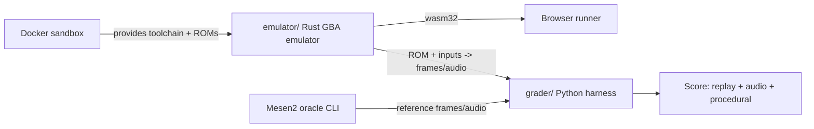

# Architecture — GBA Eval

## 1. Overview

A miniature agentic-coding eval: a from-scratch Rust GBA emulator (the "candidate") is graded by a Python harness against a black-box Mesen2 oracle (the "reference"), packaged in a Docker sandbox with a task statement and an oracle CLI — mirroring how frontier coding agents are evaluated.

## 2. Goals / Non-goals

**Goals**
- A working GBA emulator (CPU, PPU, APU, timers, DMA) that boots real test ROMs and renders playable frames.
- A 3-signal grading harness (replay SSIM 60% / audio spectrogram 20% / procedural ROMs 20%) matching GBA Eval's methodology.
- A reproducible Docker sandbox + oracle CLI + task statement.
- Compile the emulator to WebAssembly for a browser demo.

**Non-goals**
- Beating the GBA Eval leaderboard (a frontier-model benchmark, out of scope).
- Cycle-exact or Mesen2-level accuracy — "playable + correct-enough-to-grade" is the bar.
- Training or running LLM agents ourselves.

## 3. Component diagram

## 4. Components

- **emulator/** — Rust GBA core: ARM7TDMI (ARM + Thumb), memory map + I/O registers, PPU (modes 0–5, backgrounds, sprites), APU (4 PSG channels + 2 FIFO), timers, DMA, interrupt controller. Emits frames (RGBA) + audio (PCM).
- **grader/** — Python: `replay.py` (per-frame SSIM), `audio.py` (log-mel spectrogram distance), `procedural.py` (test-ROM pass/fail), `score.py` (weighted aggregate).
- **environment/** — `Dockerfile`, `TASK.md` (the task statement / ABI spec), `oracle.py` (black-box Mesen2 wrapper: run ROM + input sequence → reference frames/audio).
- **docs/** — architecture, ADRs, phases, roadmap.

## 5. Data model

| Artifact | Shape |
|---|---|
| Frame | 240×160 RGBA (u8 × 4) |
| Audio buffer | 32,768 Hz PCM, s16le, stereo |
| ROM | `.gba` byte image |
| Input sequence | timed key events (A/B/L/R/Start/Select/D-pad) |
| Score | `{ replay: 0..1, audio: 0..1, procedural: 0..1, overall: 0..1 }` |

## 6. Key decisions

See `docs/adr/`:
- ADR-001 — Rust + wasm32 target.
- ADR-002 — Mesen2 as black-box grading oracle.
- ADR-003 — Scoring methodology (SSIM/audio/procedural weighting).
- ADR-004 — Environment design (Docker sandbox, oracle CLI, no internet, checkpoints).
- ADR-005 — Build order (CPU → memory/timers/DMA → PPU → APU → graders → sandbox).

## 7. Honesty boundary

- Portfolio project: a working emulator + grading harness + sandbox. **Not** leaderboard-competitive, **not** cycle-accurate, **not** affiliated with Mechanize.
- Mesen2 is invoked as a black-box binary oracle; its source is never read, and it is not vendored or modified (it is GPL — used as an external process only).
- No claim of "training frontier models" — this demonstrates the *environment + grading* shape, not model training.

## 8. Future work

- Browser leaderboard for self-eval.
- More test ROMs (jsmolka gba-tests, armwrestler, FuzzARM).
- Audio resampler accuracy improvements.
